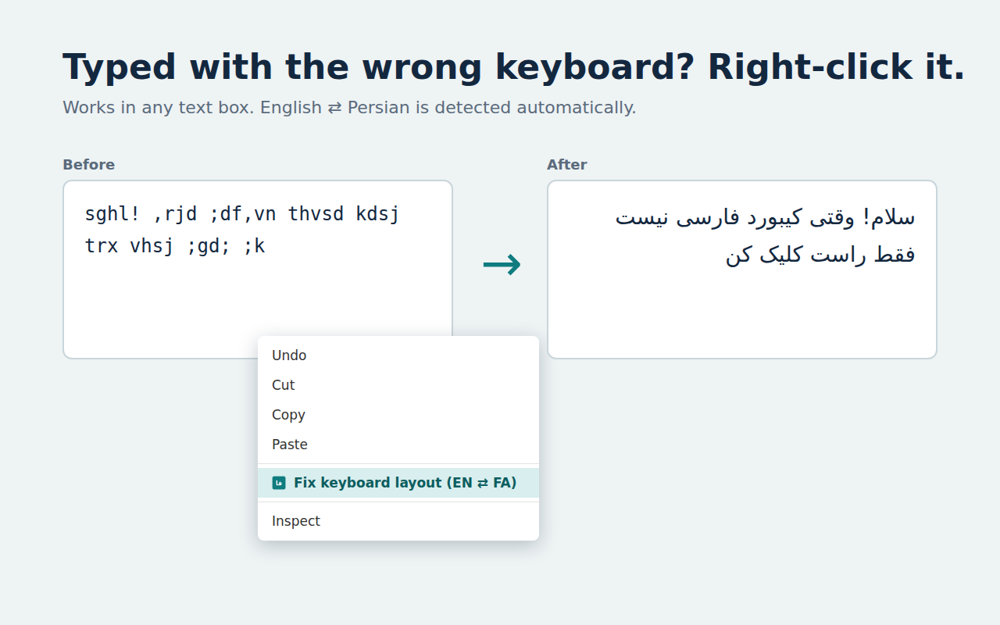

# Keyboard Layout Fixer (EN ⇄ FA)

Typed a whole sentence and then noticed your keyboard was set to English instead of Persian? Right-click the text box and choose **Fix keyboard layout (EN ⇄ FA)**.

```
sghl o,fd  →  سلام خوبی
اثممخ      →  hello
```

اگر یادتان رفته زبان کیبورد را عوض کنید، روی کادر متن راست‌کلیک کنید و «Fix keyboard layout» را بزنید تا متن درست شود.



## Install

- **Firefox:** [Firefox Add-ons](https://addons.mozilla.org/en-US/firefox/addon/keyboard-layout-fixer-en-fa/)
- **Microsoft Edge:** [Edge Add-ons](EDGE_LINK)
- **Chrome:** coming soon

More about the project (in Persian): [grizzly.ir/projects/keyboard-layout-fixer](https://grizzly.ir/projects/keyboard-layout-fixer/)

## Features

- **Both directions, detected automatically:** English → Persian and Persian → English.
- **Selection or whole box:** select part of the text to fix only that part, or nothing to fix the whole box.
- **Rich editors too:** works in Gmail, WhatsApp Web, Telegram Web and other editable areas.
- **Both Windows layouts:** Persian and Persian (Standard), chosen in the extension's options or the toolbar popup.
- **Toolbar popup:** paste any text and convert it.
- **Private:** no data is collected or sent. See [PRIVACY.md](PRIVACY.md).

## Project structure

```
src/                 shared code for every browser
  converter.js       key maps for both layouts + conversion functions
  fix-in-page.js     injected into the page to fix the focused text box
  popup.html/.js     toolbar popup
  options.html/.js   layout setting
platform/
  chrome/            Chrome + Edge (Manifest V3): manifest.json, background.js
  firefox/           Firefox (Manifest V2): manifest.json, background.js
store/               store images
build.sh, build.ps1  build scripts
```

The Firefox and Chrome versions differ only in their manifest and background script: Firefox uses the `menus` and `tabs.executeScript` APIs, Chrome and Edge use `contextMenus` and `scripting`.

## Build

macOS / Linux:

```sh
./build.sh
```

Windows (PowerShell):

```powershell
powershell -ExecutionPolicy Bypass -File .\build.ps1
```

Both create `dist/` with an unpacked folder and a store-ready zip for each browser. Keep the `version` in both manifests the same; the build stops if they differ.

## Test locally

- **Firefox:** open `about:debugging` → **This Firefox** → **Load Temporary Add-on…** → pick `dist/firefox/manifest.json`.
- **Chrome / Edge:** open `chrome://extensions` or `edge://extensions` → turn on **Developer mode** → **Load unpacked** → pick `dist/chrome-edge`.
- **Check the Firefox build:** `npx web-ext lint --source-dir dist/firefox`

## License

[MIT](LICENSE) © Ehsan Shariaty · [grizzly.ir](https://grizzly.ir)
